<div align="center">

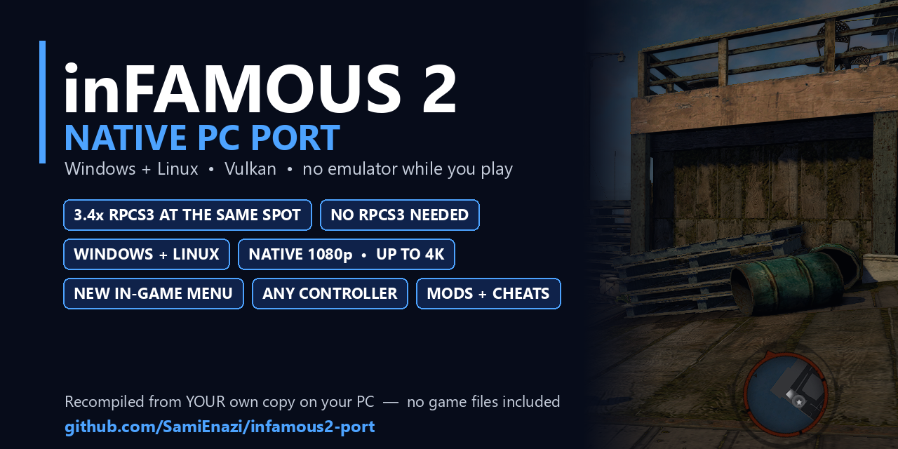

# inFAMOUS 2: native PC port

**Your own PS3 copy of inFAMOUS 2, recompiled into a real PC program for Windows and Linux.**<br>
No emulator while you play, and no emulator to install it.

[](../../releases/latest)
[](#what-you-need)
[](#linux-and-steam-deck)
[](#how-it-works)
[](#what-you-get)
[](#performance)
[](#what-you-get)
[](LICENSE)
[](#made-with-claude-code)
[](https://github.com/SamiEnazi/infamous2-port)

<a href="https://recomplauncher.com"><picture><source media="(prefers-color-scheme: dark)" srcset="https://recomplauncher.com/assets/press/launcher/badge-light.svg"></picture></a>

</div>

## What this is

Setup translates the game's PS3 code into PC code **on your machine**, from your own copy, and compiles it. The
game then runs directly on your CPU, with its graphics drawn through Vulkan: native 1080p up to 4K, any
controller or keyboard and mouse, an in-game settings menu, mods, cheats, a save manager and trophies.

> **No game content is included, and none is downloaded.** You need your own copy of the game. Builds of the
> game (the `.exe`) are never shared, because they contain the game's code. Each player builds their own.

## Install in 3 steps

1. Download **`Setup.exe`** from the [latest release](../../releases/latest) and put it in a folder on a local
   drive, for example `C:\Games\inFAMOUS2`.
2. Run it and pick **your game**: its folder, a disc image (`.iso`) or a PSN package (`.pkg`). Use the button or
   drop it on the window. Setup says which game it is before anything is downloaded.
3. Press **Install**, wait, press **Play**.

That's all. No RPCS3, no Git, no Python, no Visual Studio, no admin rights, and nothing is installed into Windows.
Setup downloads about 85 MB from GitHub (the port and its own tools) and 433 MB from Sony's servers (the game's
1.04 update and the PS3 system software, the same files a PS3 downloads), copies your game into the port's folder
and builds it once. On the test PC the whole install took 12 to 15 minutes.

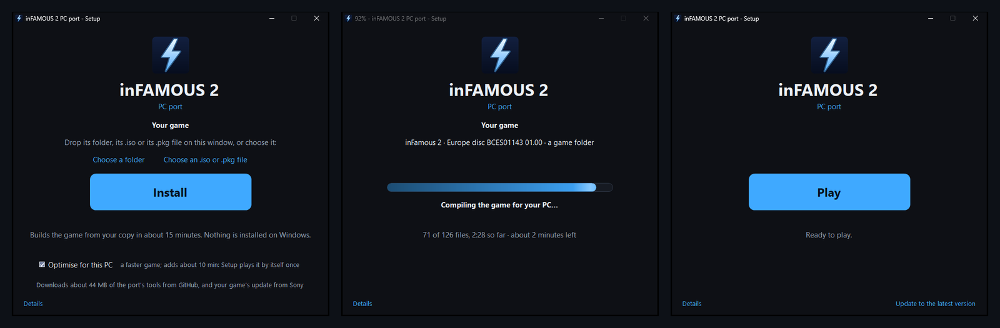

Linux and the Steam Deck: [see below](#linux-and-steam-deck). More detail on copies and keys: [FAQ](#faq).

## What's new in v0.6.2

A stability update.

- **Windows: no Visual C++ runtime needed.** On a PC without it the game did not start ("MSVCP140.dll was not
  found"). The game now carries what it needs.
- **Linux: the game's window opens on Wayland** ([#54](../../issues/54), [#44](../../issues/44)); Setup's folder
  question no longer becomes the folder; and Setup stops, and says what to do, when the game would be built
  without its shader translator and draw nothing ([#61](../../issues/61), [#69](../../issues/69)).
- **Direct mouse: a fast flick turns the camera 1:1** ([#59](../../issues/59)): the whole turn at once, nothing
  after the mouse stops. And the **Alt keys can be bound** ([#68](../../issues/68)).
- **Low-end PCs:** the start notice names the 720p picture it chose ([#73](../../issues/73)).

## What's new in v0.6.1

- **Windows 10: Setup installs again.** v0.6.0 stopped on Windows 10 with *"unpacking llvm-22.1.8-slim-win-x64.7z
  failed: tar.exe: LZMA codec is unsupported"* ([#62](../../issues/62), [#70](../../issues/70)): it used Windows'
  own tar.exe, and only Windows 11's can read that file. Setup now unpacks its compiler with its own Python and
  needs nothing from Windows for it. If v0.6.0 stopped there for you: get this `Setup.exe` and run it in the
  same folder, or just press **Try again**.
- **DLC is picked up** ([#56](../../issues/56), [#48](../../issues/48)): Setup copies your DLC's unlock files
  from RPCS3 when it has them, and files you put in the port's `dlc` folder are used at the next start
  ([FAQ](#faq)).

## What's new in v0.6.0

**Install**
- **One small Setup, one pick.** About 85 MB from GitHub instead of 1.3 GB of build tools, and no Microsoft
  license to accept.
- **No RPCS3 needed.** The update and firmware come from Sony's servers.
- **PSN copies and encrypted disc images are supported,** new in this version: a PSN copy with your `.rap`
  license, an encrypted disc image with its disc key file.
- **A progress display that always moves:** each long step says in plain words what it is, how far it is and
  about how many minutes are left.
- **Fully portable.** Your game is copied into the port's folder (about 9 GB), and settings, saves, mods and the
  shader cache live there too. Copy the folder to another drive or PC and it plays.
- **Any folder name works:** `&`, `%`, `!`, `'`, `( )`, `[ ]`, other alphabets, very long paths
  ([#34](../../issues/34), [#19](../../issues/19), [#41](../../issues/41)).

**In the game**
- **A new F2 menu** over the live game: [see below](#the-f2-menu).
- **Sharper shadows:** the sun's shadows are drawn at twice the PS3's resolution by default, with a 4x option.
- **MSAA 2x / 4x** as an option. Off by default: it costs a lot of GPU time (4x: about 40% of the frame rate at
  1080p on the test PC).
- **Mesh trimming is off by default:** whole meshes are drawn, so nothing small goes missing.
- **Faster, most of all on small CPUs:** [Performance](#performance).

**Linux**
- `./setup.sh` now works on distributions that keep their libraries in `lib64` (Fedora, openSUSE), stops with a
  clear message when glslang could not be built, and NixOS has its own environment file
  ([#64](../../pull/64), the first community pull request, thanks to [ANewJanuary](https://github.com/ANewJanuary)).

**Fixed**
- The digital (PSN) version's own folder is taken directly ([#40](../../issues/40)).
- 16:9 on an ultrawide screen keeps its shape with black bars ([#35](../../issues/35)); the wide picture no longer
  flickers to 16:9 ([#47](../../issues/47)).
- The window can be resized, and F2 → Display → *Capture-friendly window* helps Lossless Scaling and OBS
  ([#51](../../issues/51)).
- The game's first-start HDD install finishes properly (it was made again at every start).
- AMD Radeon RX 7000 / 9000 with an Adrenalin driver older than 26.6.1: the game says so once.

**Known limits of this version**
- **AMD graphics cards** keep the earlier, conservative graphics path: the new GPU-side optimisations are off
  there until they are tested on AMD hardware. The CPU-side gains apply.
- **Linux:** this version was built and run by us on one Linux PC only (Ubuntu 22.04, Radeon RX 550, RADV). Other
  distributions and graphics cards: please [report](../../issues).
- **`Setup.exe` is not code-signed,** so Windows or an antivirus may warn about it ([FAQ](#faq)).

Every version and its changes: [Releases](../../releases).

## The F2 menu

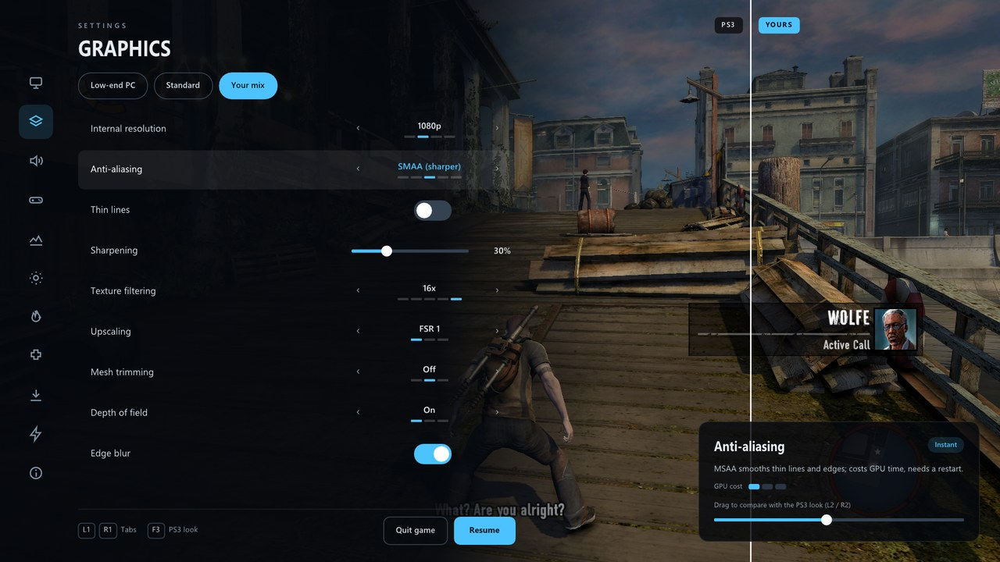

Press **F2** (or hold L3+R3) while you play:

- The game stays visible behind a panel on the left.
- One icon per page: Display, Graphics, Audio, Controls, HUD, Lighting, Effects, Mods, Update, Cheats, About.
  Change page with L1 / R1, Q / E, or a click.
- **Presets** on the Graphics page: *Standard* and *Low-end PC*. Change anything and it becomes *Your mix*.
- **One line of help per setting:** what it does, what it costs, and whether it applies at once or after a restart.
- **A PS3 | YOURS compare line** for the picture settings: drag it across the screen to see the PS3's picture
  beside yours. Hold **F3** for the whole PS3 look.
- **About:** the version, the project page, and the people who support the port.
- Two themes: Hero (blue) and Infamous (red).

## Performance

Everything here was measured on one test PC on 17 Nov 2026: i5-13600K, RTX 2070 Super, 32 GB, Windows 11. The game
drew at 720p internal (the PS3's own resolution) on both sides, uncapped, with the build Setup makes.

**Against RPCS3**

<picture>
  <source media="(prefers-color-scheme: dark)" srcset="docs/perf-dark.svg">
  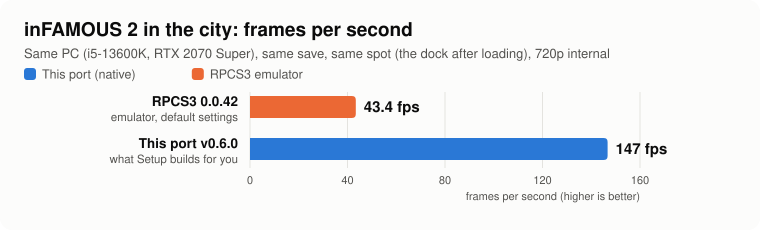
</picture>

Same PC, same save, same spot (the city dock right after loading): RPCS3 0.0.42 ran at **43 fps**, this port at
**147 fps: 3.4x**. In the three lighter views from the same spot it is 3.6x to 4.9x (up to 251 fps against 51).
RPCS3 ran with its default settings (LLVM recompilers, Vulkan, 100% resolution scale), with its frame limit and
VSync off so it is uncapped too; the settings RPCS3's own database recommends for this game were slower (31 fps),
so they were not used. Medians of 3 runs.

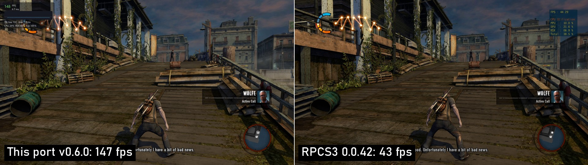

**On a smaller CPU**

<picture>
  <source media="(prefers-color-scheme: dark)" srcset="docs/perf-cpu-dark.svg">
  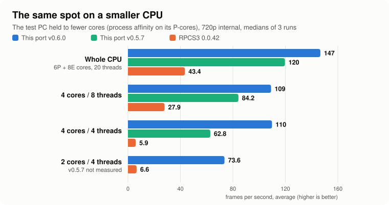
</picture>

The same spot with the test PC held to fewer cores, average fps:

| CPU limit | RPCS3 0.0.42 | Previous version | v0.6.0 | v0.6.0 against the previous version |
|---|:-:|:-:|:-:|:-:|
| Whole CPU (20 threads) | 43 | 120 | **147** | +23% |
| 4 cores / 8 threads | 28 | 84 | **109** | +30% |
| 4 cores / 4 threads | 6 | 63 | **110** | **+75%** |
| 2 cores / 4 threads | 7 | not measured | **74** | |

- On 4 cores / 4 threads the port went from 63 to 110 fps. RPCS3 is not playable there on this PC (6 fps).
- These rows are the i5-13600K held to its fast cores by process affinity, **not a real old 4-core PC**. No real
  low-end PC was measured: if you play on one, your numbers in an [issue](../../issues) are welcome.
- "Previous version" is v0.6.0's Setup with the engine of v0.5.7.
- A browser and other programs were open during the runs (0.2 to 0.5 cores); the runs repeat within 1-3%.
- The average is higher everywhere, but the slowest 1% of frames at the whole CPU is not better than before (84
  fps against 95), so this version does not claim to be smoother.

At native 1080p with the default picture settings, where the graphics card does more of the work, v0.6.0 is 9%
and 12% faster than the previous version in the two heaviest city views, and 2.5% to 19% in the opening fight.

Story videos and cutscenes run at 30 fps in both, as on the PS3.

## What you get

- **Native 1080p and up:** F2 → Graphics → *Internal resolution*: 720p / 1080p / 1440p / 4K, with SMAA, FXAA or
  MSAA, FSR 1 upscaling and sharpening.
- **Any controller, plug and play:** Xbox, DualShock 4, DualSense, Switch Pro, 8BitDo and every pad in the
  community [SDL_GameControllerDB](https://github.com/mdqinc/SDL_GameControllerDB). The button pictures follow what
  you play with. Every button and key can be remapped in F2 → Controls.
- **Direct mouse aiming:** the mouse turns the camera directly, as in a PC game, with separate sensitivity for
  aiming.
- **Enhanced lighting:** soft, sharper sun shadows, full-resolution ambient occlusion, smooth light gradients.
  F3 flips to the original PS3 look.
- **HD fire, smoke and effects:** drawn at full resolution instead of the PS3's 512×288, plus texture packs.
- **Widescreen:** 21:9, 32:9 and 16:10. You see more at the sides, nothing is stretched.
- **Cheats (F2 → Cheats):** invincibility, infinite energy, super jump, karma rank, unlock all powers, one-hit
  kills, longer glide, black lightning, saved spots (F7) and more.
- **Mods:** [see below](#mods).
- **Save manager:** every save with its picture, mission, completion and date; New Save Data, overwrite, delete.
- **Trophies:** the game's 52 trophies unlock as on a PS3, and Playnite and RecompLauncher can read them.
- **Languages:** F2 → Audio → Language picks voice and text separately, from what your disc has.
- **Field of view slider, depth of field switch, a frame rate cap, an fps counter (F1).**

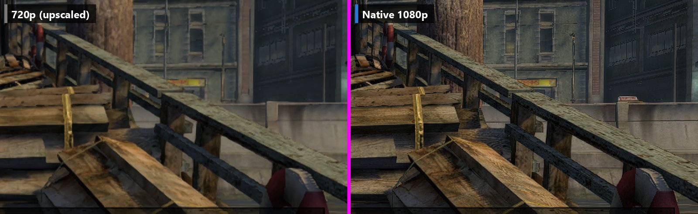

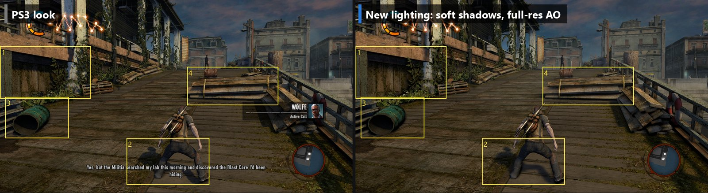

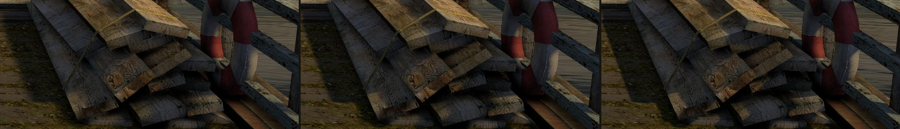

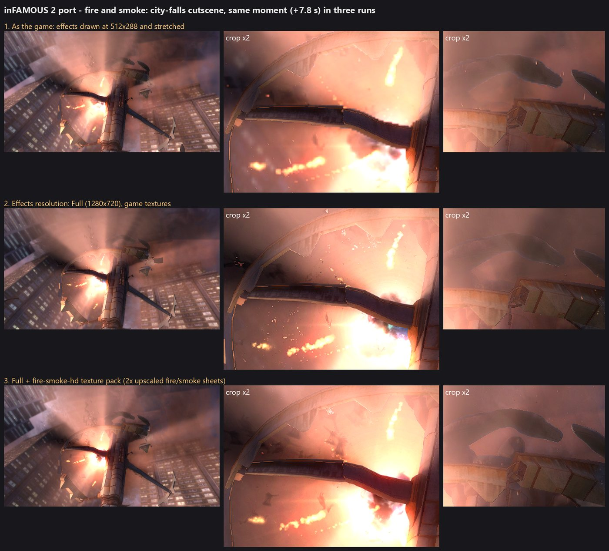

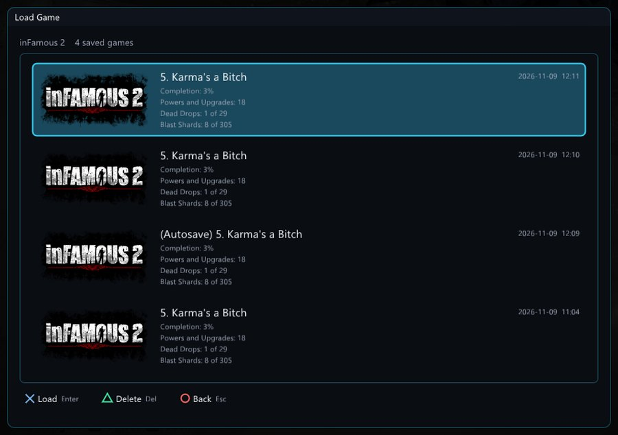

<details>
<summary>Trophies in Playnite and RecompLauncher</summary>

The port keeps its trophies in `game\gamedata\trophies\NPWR01730.json` and also writes them the way RPCS3 does,
in `game\gamedata\dev_hdd0\home\00000001\trophy\NPWR01730_00\`, so trophy trackers made for RPCS3 can read them.

**Playnite** ([Playnite Achievements](https://github.com/justin-delano/PlayniteAchievements) or
[SuccessStory](https://github.com/Lacro59/playnite-successstory-plugin)). Both look for an emulator with RPCS3 in
its name, so the port gets one:
1. Library → Configure Emulators → Add: name it `RPCS3 inFAMOUS 2 port`, installation folder
   `<port folder>\game\gamedata`, and one custom profile whose executable is `<port folder>\Play inFAMOUS 2.cmd`.
2. Add the game by hand: installation folder `<port folder>\game\disc\PS3_GAME`, and a play action of the Emulator
   type with that emulator and profile.
3. Playnite Achievements: turn on its RPCS3 source. SuccessStory: Settings → RPCS3 → turn it on and add
   `<port folder>\game\gamedata\dev_hdd0\home\00000001` as a home user folder.
4. Start the game once (the folder is made then), then refresh the game's achievements.

Already set up for RPCS3? Add `PS3_TROPHY_RPCS3_DIR=<your RPCS3 folder>` to `settings.ini` and the port also
copies its unlocks into RPCS3's own trophy folder for the game. It never locks anything or moves a date later
there, and it keeps a copy of RPCS3's file once (`TROPUSR.DAT.port-backup`).

**RecompLauncher:** started from RecompLauncher, the port reports each trophy to
[Recomp Achievements](https://github.com/elripalda/RecompAchievements). A cheat that changes play makes the
session's later unlocks Casual. Picking or saving a spot and Black lightning don't.
</details>

## What you need

- **Your copy of inFAMOUS 2.** Confirmed by players: the Europe disc (BCES01143), the Turkey disc (BCES01229) and
  the US disc (BCUS98125), and the digital (PSN) version 01.03 (NPUA80638 / NPEA00318). In one of these forms:
  - the game's **folder** (the one that holds `PS3_GAME`, or the PSN version's own folder)
  - a **disc image** (`.iso`)
  - a **PSN package** (`.pkg`)
- **A PC with:** Windows 10/11 64-bit (or [Linux](#linux-and-steam-deck)), a CPU with AVX2 (Intel 4th gen / AMD
  Ryzen or newer), a Vulkan graphics card, 16 GB RAM, about 16 GB free disk space on a local drive (not a network
  drive).
- **Internet for the install:** about 85 MB from GitHub and 433 MB from Sony.

Tested PCs: the test PC above at 1080p to 4K; players on Windows 10 and 11 up to an RTX 5070 at 1440p; Linux on
Ubuntu 22.04 with a Radeon RX 550 (RADV), and a player's Steam Deck ([#24](../../issues/24)).

## Linux and Steam Deck

The port builds and runs natively on Linux, with no Wine or Proton. There is no Setup.exe on Linux: `./setup.sh`
does the same job, and needs no RPCS3 either.

Download `inFAMOUS2-port-v…-Linux-x64.zip` from the [latest release](../../releases/latest), unpack it and run
`./setup.sh`. The first time it asks for your game folder, gets the update and firmware from Sony's servers,
copies the game into the port's folder, builds it, then starts it. After that, `./setup.sh` just plays. Or from git:

```
git clone https://github.com/SamiEnazi/infamous2-port
cd infamous2-port
./setup.sh                      # or: ./setup.sh --disc <your game folder>
```

- `tools/setup.sh` lists what it needs from your distribution (a C/C++ toolchain, python3 with venv, the Vulkan
  loader, SDL2). Unlike Windows, it downloads its build tools (LLVM 22.1.8, CMake / Ninja when the system has none)
  and builds the engine itself: there are no prebuilt Linux tools yet.
- **Fedora, openSUSE** and other `lib64` distributions work since v0.6.0 ([#64](../../pull/64)).
- **NixOS:** build and play inside the FHS environment in [`tools/nixos/fhs-env.nix`](tools/nixos/fhs-env.nix)
  (the commands are at the top of that file). Tested by its author on NixOS 26.05 with a Radeon 780M.
- **Steam Deck:** a player built it inside an Ubuntu Distrobox container in Desktop Mode and plays it in Game Mode
  ([#24](../../issues/24)).
- **v0.6.0 on Linux was built and run by us on Ubuntu 22.04 with a Radeon RX 550 (RADV)**: it installs, starts and
  plays there (slowly: that card is the limit). No Linux frame rate is claimed. Please [report](../../issues) how it runs on
  your distribution and GPU.

## Updates

- When the game starts it asks GitHub whether a new version is out (in the background, at most every 6 hours;
  offline it just starts). **F2 → Update** shows what's new and installs it. Your saves, settings, mods and
  controls are kept, and the saves are copied to `saves-backup\` first.
- An update rebuilds only what changed, so it takes minutes.
- **From v0.5.x:** F2 → Update (or `Setup.exe` on your folder) moves the install to the new layout. It deletes the
  old 2 GB of build tools and copies your game folder into the port's folder (it asks once and shows the size;
  your folder is not changed).
- F2 → Update → *Check for updates automatically* turns the check off, and with it the supporters list of the
  About page. Nothing about you or your PC is sent.
- A copy installed by RecompLauncher is updated by RecompLauncher.

## Playing

Start with `Play inFAMOUS 2.cmd` or the desktop shortcut. For Steam, Playnite and other launchers, add
`work\port\build\Infamous2Recomp.exe` from the port's folder; Steam Input and the Steam overlay work.

| Key | Action |
|---|---|
| **F1** | fps counter |
| **F2** (or hold L3+R3) | the settings menu |
| **F3** | your picture vs the original PS3 look |
| **F7** | go to your saved spot |
| **F9** | mark a moment in the session log (a stutter, a glitch) |
| **Alt+Enter** | fullscreen |

Keyboard and mouse: WASD to move, mouse for the camera, right button to aim, left button to shoot,
Space = ✕, Shift = ○, F = □, Q = △. Remap anything in F2 → Controls → *Buttons and keys*.

## Mods

The community's inFAMOUS 2 mods made for tiffsomniac's **inFAMOUS Mod Manager** work as they are (whole files,
texture patches, xpps patches, and mods with options).

- **F2 → Mods → Add a mod from a zip** takes the zips in your Downloads folder (only mod files are taken out,
  never a program), or unzip a mod into the `mods` folder yourself (`mods\<mod>\mod.json`).
- No Unlocker and nothing to install: your game files are never changed.
- Turn each mod on or off and pick its options in F2 → Mods, then **Restart to apply**.
- When two mods change the same file, **Use this one instead** picks the winner.

How it works and the mod format: [`engine/docs/MODS.md`](engine/docs/MODS.md).

## FAQ

**Do I need RPCS3?**
No. Since v0.6.0 Setup gets the game's update and the PS3 system software from Sony's servers itself. If RPCS3 is on
your PC and already has them, Setup copies them from there instead, and that is all it is used for.

**I have the PSN (digital) version.**
Pick its folder (`NPUA80638` / `NPEA00318`) or its `.pkg`. It is unlocked with your own license, the `.rap` file:
put `<CONTENT_ID>.rap` beside the game and it is found by itself, otherwise Setup asks for it. No license is
shipped with the port. PSN support is new in this version and was made without a real PSN copy on the test PC, so
if Setup stops, please [report](../../issues) it with Setup's log (Details → Copy log).

**My disc image (`.iso`) is encrypted.**
A decrypted image is read directly. An encrypted one (a raw copy of the disc) needs its disc key, a `.dkey` or
`.ird` file: put it beside the image with the same name (`game.iso` + `game.dkey`), otherwise Setup asks for it. A
3K3Y image carries its key. No key is shipped with the port. New in this version.

**Windows or my antivirus warns about Setup.exe.**
`Setup.exe` is not code-signed, because signing a program costs money. So Windows SmartScreen or an antivirus may
warn about it, as they can for any new, unsigned file. On the Windows message, click **More info**, then **Run
anyway**. The source is open (`tools/setup_exe/` in this repository), and here is the VirusTotal scan of this
release's `Setup.exe`: https://www.virustotal.com/gui/file/756d6f24fa0eba885f12a8d5993db466578f3189bf7674d09b9aae9372f5e233

**Does DLC work?**
Yes, when its unlock files are in the port's folder. inFAMOUS 2's DLC (the extra skins, amps and powers) is a set
of small unlock files, `dev_hdd0\game\<your game's ID>\USRDIR\dlc\ulf\unlock_*.edat`; the content itself is
already in the game. A game copy that carries them (a PSN folder with the DLC installed) brings them along. From
v0.6.1 Setup also copies them from RPCS3 when it is on your PC and has the DLC installed, on install and on every
update (added DLC to RPCS3 later? run Setup again). And there is a `dlc` folder in the port's folder: put the
`.edat` files there and they are picked up the next time the game starts. The DLC must be for the same version
(region) of the game as your copy. DLC that needs a license (`.rap`) is not supported yet.

**Where are my saves and settings?**
All in the port's folder. Saves: `game\gamedata\dev_hdd0\home\00000001\savedata`, backed up to `saves-backup\`
before every session. Settings: `settings.ini`, `mods.ini`, `spots.ini`, and your controls in `input.toml`.

**Can I move the folder?**
Yes. Move or copy the whole port folder to another drive or PC and start `Play inFAMOUS 2.cmd`. The desktop
shortcut is made again by itself.

**How do I uninstall?**
Delete the port's folder and the desktop shortcut (copy your saves out first). Nothing was installed into Windows.
Your original game is never touched. Only if you used a version before v0.6.0: also delete
`%APPDATA%\inFAMOUS2-port` and `%LOCALAPPDATA%\inFAMOUS2-port`.

**The game looks or runs wrong.**
Please [open an issue](../../issues) and attach the newest `play\<date-time>` folder: it holds the frame times,
your F9 marks and every long frame with what the game was doing.

## Contributing

- **Bug reports** with the session's `play\<date-time>` folder are the most useful thing.
- **Test reports** are wanted for: AMD graphics cards, Linux distributions, a real PSN copy, an encrypted disc
  image, and old or small CPUs.
- **Pull requests** are welcome and are reviewed by the owner before they are merged. The first one,
  [#64](../../pull/64), is in v0.6.0.
- Never post game files, keys, licenses or builds of the game.

<a name="without-setupexe"></a>
<details>
<summary>Without Setup.exe (git)</summary>

```
git clone https://github.com/SamiEnazi/infamous2-port
```

Then run **`Setup.cmd`**, or from PowerShell:

```
tools\setup_build.ps1 -Source <your game folder, .iso or .pkg> [-Rpcs3 <your RPCS3 folder>] -Cleanup
```

Updating later is the same (`git pull` first). `-Cleanup` keeps the tools and build files, so only what changed
is built again. `-NoBuildCache` deletes them too.
</details>

<details>
<summary>Your own decryption tool (advanced)</summary>

Setup hands the game's 1.04 `EBOOT.BIN` and three firmware modules to a decryptor, by default ps3tool
(`tools/ps3tool.py`), and checks that what comes back is a decrypted program. To use another tool, put a line
like this in `config.local.json` in the port's folder:

```
"decryptor": "\"C:\\Tools\\mydecrypt.exe\" \"{in}\" \"{out}\""
```

`{in}` is the encrypted file and `{out}` where the decrypted one must go.
</details>

## Supporters

The port is free. If you'd like to support the work, you can here: [paypal.me/samiEnazi](https://paypal.me/samiEnazi).
Supporters and contributors are listed in the game, in **F2 → About**.

Contributors: [ANewJanuary](https://github.com/ANewJanuary) (Linux setup, [#64](../../pull/64)).

## How it works

- [ps3recomp](https://github.com/sp00nznet/ps3recomp) translates the game's PowerPC (PPU) and SPU code, and
  three PS3 firmware modules from **your** download of the PS3 system software, into C/C++. The small clang + lld
  compiler Setup brings then compiles it on your PC.
- The engine is prebuilt: it is a release asset with no game code in it.
- The engine's runtime stands in for the PS3 system (files, threads, audio, input, saves, system dialogs), draws
  the PS3 graphics chip's commands with Vulkan at any internal resolution, and runs the game's heaviest PS3 helper
  jobs as plain PC code on all cores.

| Folder | What it is |
|---|---|
| [`engine/`](engine/) | The engine: the recompiler (`engine/tools/`) and the runtime (`engine/runtime/`, `engine/libs/`). It started as [sp00nznet's ps3recomp](https://github.com/sp00nznet/ps3recomp) and is maintained here now. MIT, [`engine/LICENSE`](engine/LICENSE). |
| [`base/`](base/) | The port base: [Erik Martins' infamous2-recomp](https://github.com/erikomis/infamous2-recomp) as he published it (commit 8077cda). MIT, [`base/LICENSE`](base/LICENSE). |
| `patches/port/` | Our changes to the port base's files, applied to its copy at build time. |
| `port_src/` | Files we add to the port. |
| `cheats/` | The game side of the cheats and of the mouse camera. |
| [`natives/`](natives/) | Native versions of the game's heaviest SPU jobs. |
| `tools/` | The build, Setup, `tools/play.ps1`, and the tools used to test it. |

## Made with Claude Code

This port was built in **2 days and 9 hours**, in one long conversation between **Sami** and **Claude**
(Anthropic's Claude Opus 5.5, working in [Claude Code](https://claude.com/claude-code)): from the first message
(6 Nov 2026, 22:42) to the first public release (9 Nov 2026, 07:15). Sami brought the idea, his own copy of the
game, the direction, the playtesting and the feedback; Claude wrote the code, the tools, Setup and this README.

## Thanks and credits

This port stands on other people's work:

- **[ps3recomp](https://github.com/sp00nznet/ps3recomp)** by Ned Heller / sp00nznet and its
  contributors, and **[Noah Peterson's fork](https://github.com/NoahBPeterson/ps3recomp)**: the
  recompiler and runtime this port is built on (MIT, Copyright (c) 2026 Ned Heller / sp00nznet). This
  project started from it and our fork of it ([SamiEnazi/ps3recomp](https://github.com/SamiEnazi/ps3recomp/tree/infamous2),
  up to v0.4.2); since v0.5.0 that engine is the `engine/` folder of this repository and is maintained here,
  with its full license in [`engine/LICENSE`](engine/LICENSE) and its contributors in `engine/CONTRIBUTORS.md`.
- **[erikomis/infamous2-recomp](https://github.com/erikomis/infamous2-recomp)** by Erik Martins: the
  inFAMOUS 2 port this one started from, and the camera patch behind widescreen (MIT, Copyright (c) 2026 Erik
  Martins). It is the `base/` folder of this repository (his commit 8077cda, unchanged), with its license in
  [`base/LICENSE`](base/LICENSE) and its credits in [`base/CREDITS.md`](base/CREDITS.md).
- **[ThiagoFraga761/infamous2-pc](https://github.com/ThiagoFraga761/infamous2-pc)**: the Vulkan SSAO and
  lighting passes and Windows groundwork we adopted, the texture-cache and buffer-growth ideas behind the
  freeze fix, and the idea of giving the game's Edge geometry code the real picture size (MIT). Also
  the **native versions of the game's heaviest SPU jobs** in [`natives/spu/`](natives/): the Edge geometry
  kernels (skinning, culling, vertex decompression), the BSP polygon clipper and the render-list builder are
  ports of his `edge_kernels_native.c`, `job220_native.c` and `ec5f_native.c` to this game version (MIT,
  Copyright (c) 2026 the infamous2-recomp contributors; his notice is kept in each file), with AVX2 paths
  added here. They are what makes the port fast on 4- and 6-core CPUs.
- **[SIMDe](https://github.com/simd-everywhere/simde)** (MIT): the 68 headers the Edge kernels need are in
  `natives/spu/simde-0.8.2/`, with its license.
- **bungholio** and the [ArtemisPS3](https://github.com/bucanero/ArtemisPS3) cheat-code collection: three of the
  cheats (jump height, AI speed, enemies hold fire) are their codes for this exact game version, turned into
  menu switches, their "Hold L2 + X To Fly" code led us to the game's glide physics, and their "Have All Powers" and
  "Can Use All Powers" codes to the game's power state (see `cheats/NOTES.md`).
- **L_**: the RPCS3 patches "Black Lightning", "Static Thrusters - Flight" and "Static Thrusters - Fast" for this
  exact game version. On the port they are re-made as run-time hooks with the same effect (F2 → Cheats; how in
  `cheats/NOTES.md`).
- **tiffsomniac**: the **inFAMOUS Mod Manager** and its mod format (whole files, texture and xpps patches,
  options). The port reads these mods as they are (F2 → Mods); its own code, written from the format.
- **Yahfz**: the RPCS3 community patch "Disable Mesh Trimming" (one instruction word in the game's Edge
  geometry SPU program), which first showed why faces get holes above 720p. F2 → Graphics → *Mesh trimming*:
  *Off: whole meshes* (the default since v0.6.0) is Yahfz's patch; *At the render resolution* keeps the game's
  culling but at the real picture size, so no holes and a little faster; *The PS3's 720p culling* is the original.
- **[RPCS3](https://github.com/RPCS3/rpcs3)** and its team. Until v0.6.0, RPCS3 decrypted the game and
  firmware for Setup. It was also our reference while building the port: we compared our output against it, and its research and
  wiki taught us much of what we know about the PS3. **No RPCS3 code is included** here (RPCS3 is GPL).
- Third-party libraries used by the build, each under its own license:
  - [SDL2](https://libsdl.org) (zlib)
  - [Vulkan-Headers](https://github.com/KhronosGroup/Vulkan-Headers) (Apache-2.0)
  - [glslang](https://github.com/KhronosGroup/glslang) (BSD-3 and others)
  - [Dear ImGui](https://github.com/ocornut/imgui) (MIT)
  - [SMAA](https://github.com/iryoku/smaa) (MIT)
  - AMD FidelityFX FSR 1 / CAS (MIT)
  - NVIDIA FXAA 3.11
  - [SDL_GameControllerDB](https://github.com/mdqinc/SDL_GameControllerDB) (zlib)
  - at3_standalone (LGPL-2.1)
  - [Recomp Achievements](https://github.com/elripalda/RecompAchievements) (its own license: free for
    games, not MIT; it bundles rcheevos and cJSON, both MIT)

  Their license files are in `engine/third_party/`.

## Legal

This is a fan project for people who own the game. It is not affiliated with or endorsed by Sony
Interactive Entertainment or Sucker Punch Productions. *inFAMOUS* is a trademark of Sony Interactive
Entertainment LLC. The screenshots show the game running on this port and in RPCS3, for comparison.

This repository contains no game assets, firmware or keys, and no game code beyond the addresses and the few
instruction words the cheats switch, taken from public community codes. Everything else game-specific is read
from your own copy on your own PC. Do not share builds of the game, or files taken from it.

The code in this repository is MIT-licensed (see `LICENSE`). The engine (`engine/`, from sp00nznet's ps3recomp)
and the port base (`base/`, Erik Martins' infamous2-recomp) keep their own MIT licenses and copyright notices
(`engine/LICENSE`, `base/LICENSE`). The libraries in `engine/third_party/` keep theirs;
`engine/third_party/rl_achievements` is under the Recomp Achievements License 1.0, not MIT. The third-party
libraries the build downloads keep their own licenses.
