<div align="center">

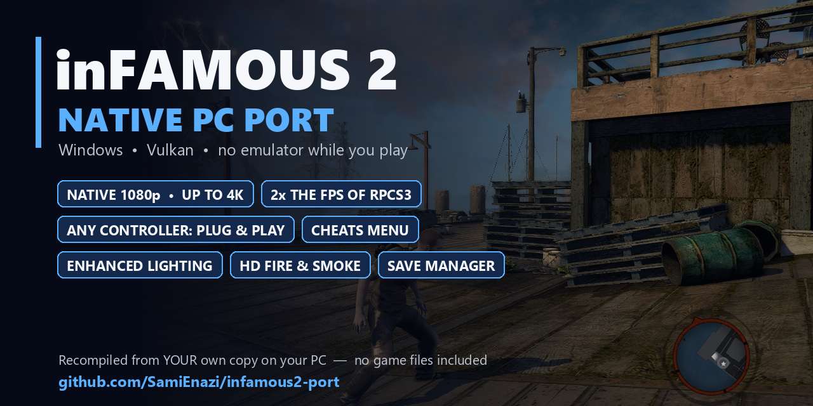

# ⚡ inFAMOUS 2: native Windows port

**Your own PS3 copy of inFAMOUS 2, recompiled into a real Windows program.**<br>
No emulator while you play.

[](#-what-you-need)
[](#-how-it-works)
[](#%EF%B8%8F-native-1080p-and-up)
[](#-performance-native-vs-rpcs3)
[](#-full-controller-support)
[](#-status)
[](LICENSE)
[](#-made-with-claude-code)
[](https://github.com/SamiEnazi/infamous2-port)

</div>

## 🚀 Performance: native vs RPCS3

<picture>
  <source media="(prefers-color-scheme: dark)" srcset="docs/perf-dark.svg">
  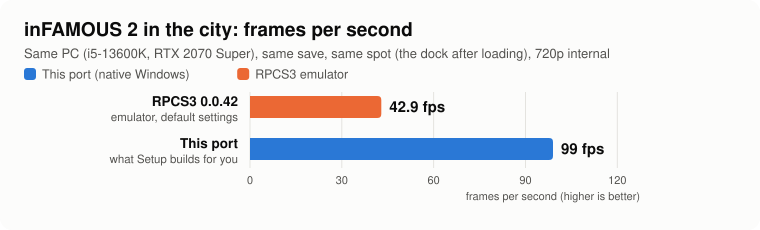
</picture>

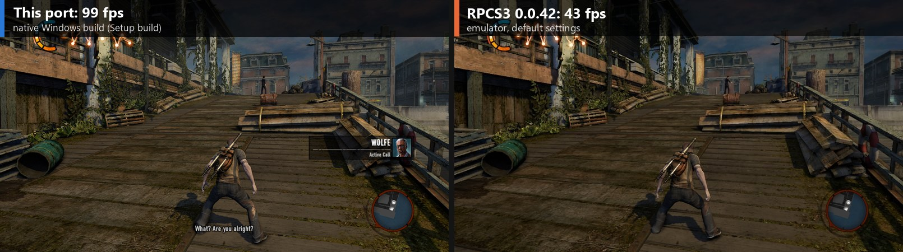

| Same PC, same save, same spot | RPCS3 0.0.42 | **This port** |
|---|:-:|:-:|
| 🏙️ City: the dock right after loading (720p) | 43 fps (39–46) | **99 fps** |
| 🎥 Camera turned to three more views (720p) | not measured | **104 / 132 / 139 fps** |
| 🖥️ The same four views at **native 1080p** with every picture extra on | | **99 / 103 / 133 / 140 fps** |
| 🔧 Developer build (profile-guided optimisation and hand-written SPU code, not in the Setup build), the same four views at 1080p with every extra | | 116 / 126 / 161 / 166 fps |

<sub>
This port: measured on 10 Nov 2026 with the build Setup makes today. RPCS3: measured on 9 Nov 2026. Both on an
i5-13600K, RTX 2070 Super and 32 GB RAM, Windows 11. The PC was a normal desktop with a browser open in the
background. RPCS3 ran with its default settings: LLVM recompilers, Vulkan, 100% resolution (720p). Here the CPU
sets the pace, so native 1080p with every extra runs as fast as 720p. Story videos and cutscenes run at 30 fps in
both, as on the PS3. "Picture extras" means soft shadows, full-resolution ambient occlusion, smooth light
gradients and full-resolution effects.
</sub>

## ✨ What you get

### 🖥️ Native 1080p and up

The game draws natively at **1080p** instead of stretching the PS3's 720p, with sharper edges, a crisp HUD and finer
detail everywhere. F2 → Graphics → *Internal resolution*: 720p / **1080p** / 1440p / 4K. 1440p and 4K use the same
code but haven't been tested yet.

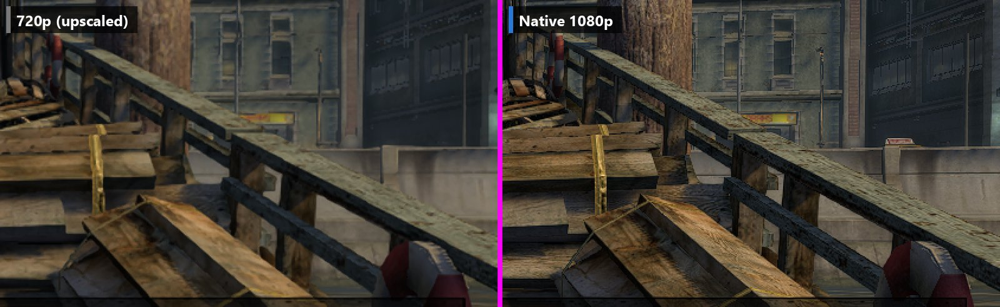

### 🎮 Full controller support

**Plug in any controller and play.**
- Xbox, DualShock 4, DualSense, Switch Pro, 8BitDo and every pad in the community
  [SDL_GameControllerDB](https://github.com/mdqinc/SDL_GameControllerDB) work out of the box.
- Turn it on before or during the game: it's picked up while you play.
- Buttons work by position, as on a PlayStation pad (bottom = ✕, right = ○).
- Prefer **keyboard and mouse**? They work too, and everything can be remapped in `input.toml`.

### 💡 Enhanced lighting

Soft sun shadows instead of stair-stepped ones, contact shadows (ambient occlusion) at full resolution instead
of half, and smooth light gradients without banding. Every option is in F2 → Lighting, and **F3** flips
between your picture and the original PS3 look.

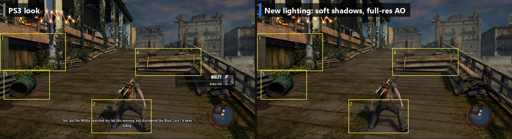

### 🔥 HD fire, smoke and effects

The PS3 drew every fire, smoke, spark and explosion into a tiny 512×288 image and stretched it over the screen,
which gave blocky edges and blobby flames. Here they're drawn at full resolution (F2 → Effects). The port also
loads **texture packs** (PNG/DDS), so the community can make HD versions of any texture. Packs are made from your
own game's textures, so none are included.

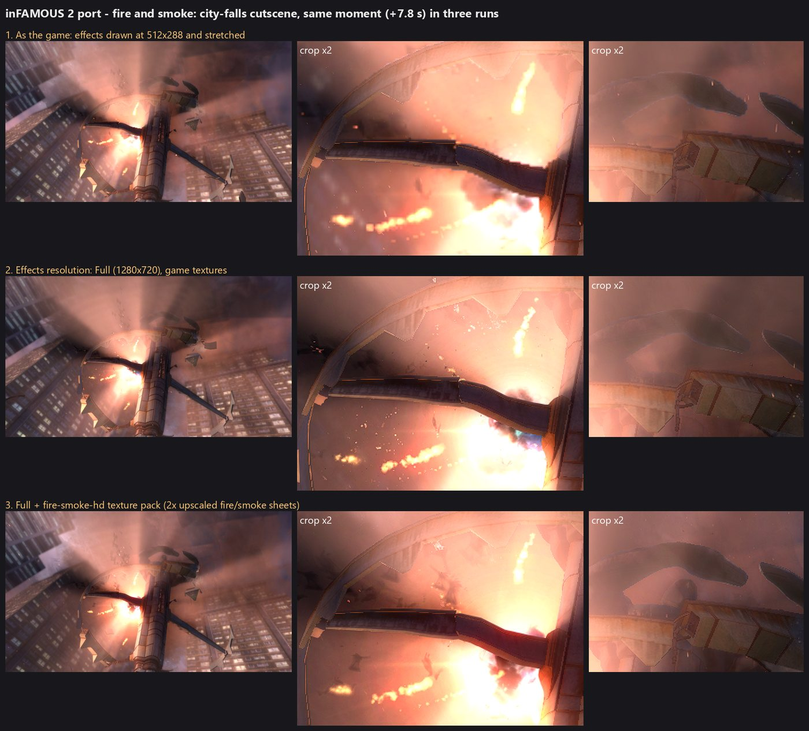

### 🧪 In-game cheats menu

F2 → Cheats:
- **Invincibility**, **infinite energy**, **max battery**
- **super jump** (2× to 10×)
- **karma lock** (blue/red only), a karma multiplier, **XP for karma**, *Add karma* / *Add XP* buttons
- **one-hit kills**, enemy speed, enemies hold fire
- **longer glide**: Cole sinks more slowly while gliding (R1, the Static Thrusters), so a glide lasts up to 3× as long and goes further

Cheats can be remembered between sessions, with a short reminder at start.

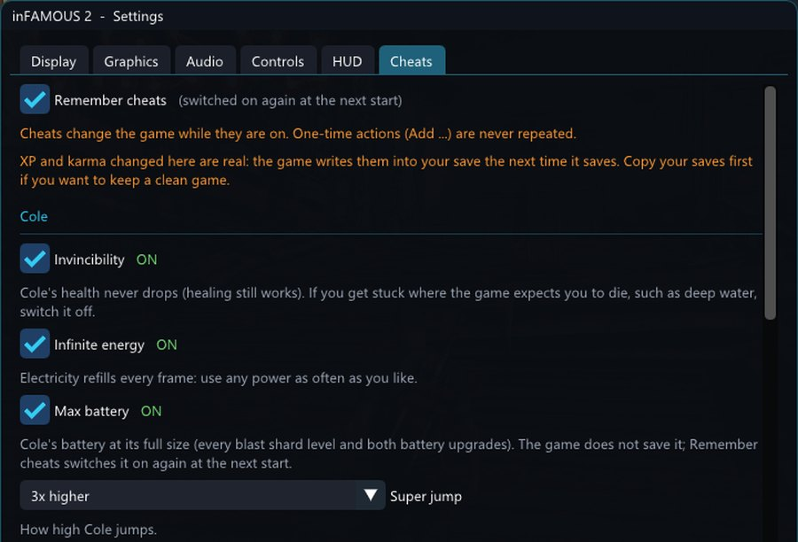

### 💾 Save manager

The PS3's own "choose a save" screen, which the port didn't have before:
- every save with its picture, mission, completion and date
- **New Save Data**, so you never overwrite by accident
- overwrite and delete, each asking first
- real Yes/No answers to the game's questions, like "save before loading?"

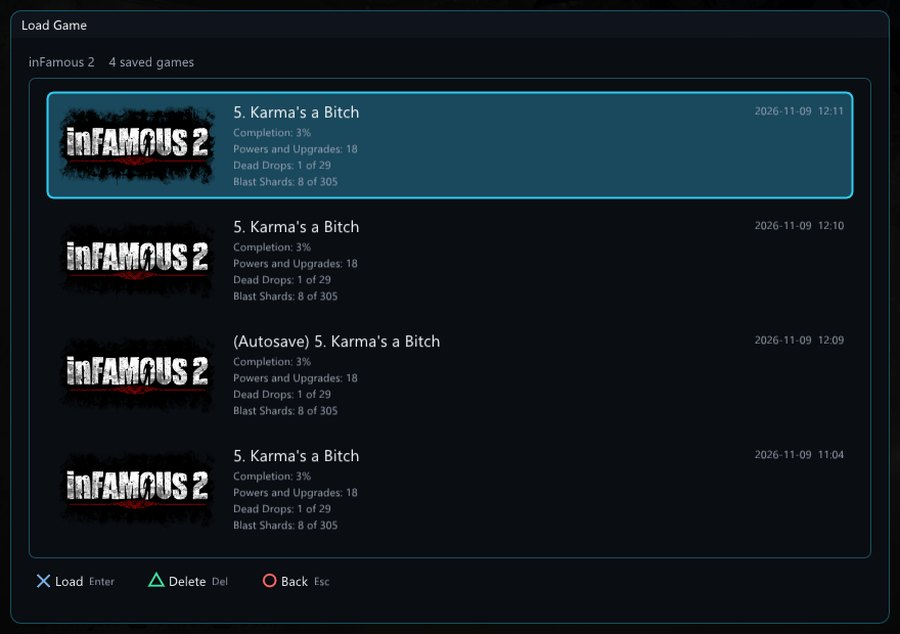

### 🎨 A menu that looks like the game

The settings menu, the save list and the game's questions share an inFAMOUS-style theme: **Hero** (electric blue)
or **Infamous** (ember red), in F2 → Display.

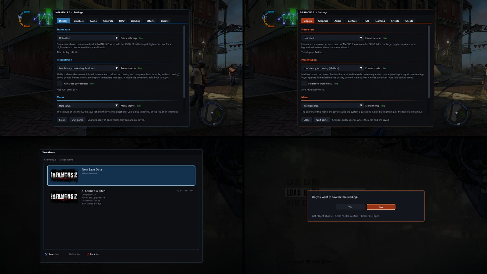

### ⚡ Smoother, too

Looking out over the city from a rooftop used to drop the game to **4–10 fps**: the texture cache was too small
and every frame rebuilt hundreds of textures. With a 4× larger cache and buffers that grow instead of stalling,
the same overflow, forced on purpose, went from **13 to 40 fps**. With normal settings the busy street in our
test ran at **75 fps with no frame over 37 ms**. That rooftop view now runs at **80–91 fps** at native 1080p with
every extra on.

Long sessions stay smooth too: in a 26-minute test in the city (developer build), no frame took longer than
150 ms after loading, and memory use stayed flat.

### 🎮 In the city on this port

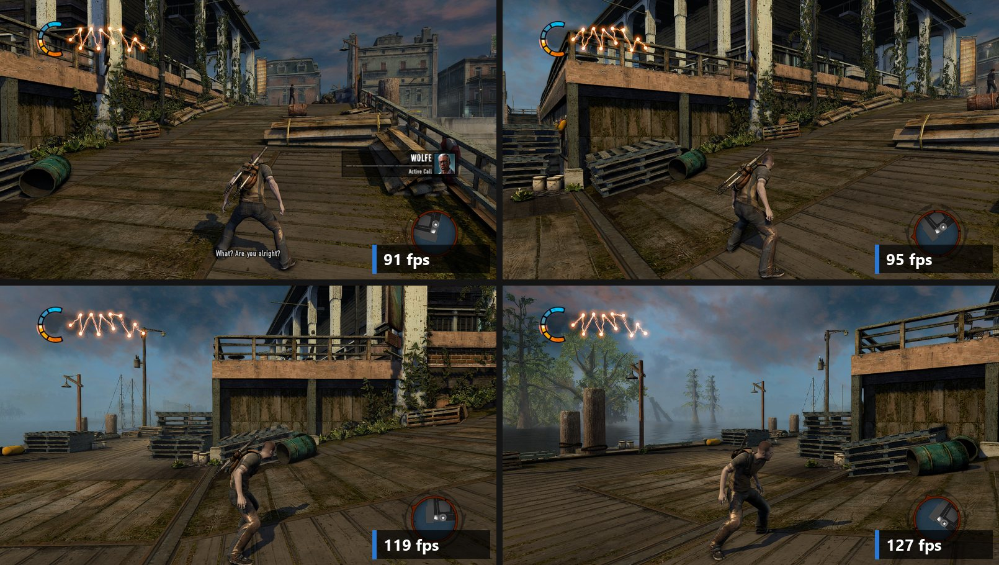

## 🧭 What this is

Setup translates the game's PS3 code into PC code **on your machine** and compiles it. The game then
runs directly on your CPU, with its graphics drawn through Vulkan.

> 🧪 **Early public test.** It boots, plays and saves, and it is fast on the PC it was built on, but
> it has only been played from the start to about mission 5, on one PC. Expect bugs; please
> [report them](../../issues).

> 🔒 **No game content is included, and none is downloaded.** You need your own copy of the game,
> and RPCS3 for Setup. Builds of the game (the `.exe`) are never shared, because they contain the
> game's code. Each player builds their own.

## 📋 Status

| | |
|---|---|
| ✅ Tested copy | Europe disc **BCES01143** + the **1.04** update. US and other discs share the same 1.04 code but are untested. |
| 🖥️ Tested PC | i5-13600K, RTX 2070 Super, 32 GB, Windows 11, 1080p |
| ⚠️ Known issues | • The Beast fight can drop into the 40s (the CPU side of fights is being worked on).<br>• Fine stripes on faces in one early cutscene (Kuo at the dock); setting Lighting → Shadow softness to *Softest* hides them. |

## 🧰 What you need

- 💿 **Your copy of inFAMOUS 2**
  - The disc's files: the folder that holds `PS3_GAME`.
  - The **1.04 update**, installed in RPCS3.
- 🕹️ **[RPCS3](https://rpcs3.net)** with the **PS3 firmware** installed (*File > Install Firmware*, using
  `PS3UPDAT.PUP` from playstation.com).
  - It is needed **only during Setup**. Setup uses it to decrypt your game, then copies into the port's
    folder the update, the firmware files the game reads (fonts, system data) and the game's HDD install.
  - After Setup you can remove RPCS3. Keep your game disc folder where it is.
  - Start the game once in RPCS3 until the main menu: that installs 2.4 GB of data that Setup copies.
- 💻 **A PC with:**
  - Windows 10/11 64-bit
  - a CPU with AVX2 (Intel 4th gen / AMD Ryzen or newer)
  - a Vulkan graphics card
  - 16 GB RAM
  - about 15 GB free disk space while it builds (about 4 GB after)
- 🌐 **Internet.** Setup downloads its build tools (about 1.3 GB) and deletes them after the build.
  **Nothing is installed on Windows**, nothing needs admin rights, and you need no Git, Python or Visual Studio.

## 📦 Install

1. ⬇️ Download **`Setup.exe`** from the [latest release](../../releases/latest) and run it. Put it in a folder on
   your PC's internal drive, for example `C:\Games\inFAMOUS2`. A USB stick or an exFAT/FAT32 external disk can't
   hold the link Setup makes to your game folder; Setup then installs into `%LOCALAPPDATA%\inFAMOUS2-port` instead.
2. ▶️ Press **Install**. That's all. Setup:
   - 📥 downloads the port's files (about 40 MB) into a folder next to itself
   - 🔎 finds RPCS3 and your game by itself (it asks only if it can't)
   - 🛠️ downloads the build tools into that folder: Python, CMake, Ninja, LLVM and Microsoft's C++ headers and
     libraries (portable copies, about 1.3 GB)
   - 🏗️ builds the game from your copy: 20–60 minutes, one time only (about 15 minutes on the test PC)
   - 🧹 deletes the build tools again and leaves a desktop shortcut. Its icon is taken from your own copy.
3. 🎮 Press **Play**.

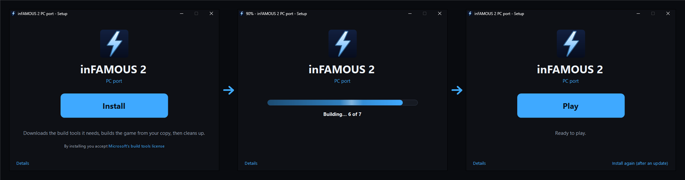

> ⚠️ Setup.exe is not signed, so Windows may say *"Windows protected your PC"* the first time: click
> **More info**, then **Run anyway**.

> 📜 Pressing Install accepts Microsoft's [Visual Studio Build Tools license](https://go.microsoft.com/fwlink/?LinkId=2179911)
> for the C++ headers and libraries Setup downloads from Microsoft.

<details>
<summary>🧰 Without Setup.exe (git)</summary>

```
git clone --recursive https://github.com/SamiEnazi/infamous2-port
```

Then run **`Setup.cmd`** (the PowerShell window), or straight from PowerShell:

```
tools\setup_build.ps1 -Disc <your game folder> -Rpcs3 <your RPCS3 folder> -AcceptMsvcLicense -Cleanup
```

Updating later is the same: Setup downloads the build tools again and deletes them afterwards.
</details>

## 🎮 Playing

- **Start:** `Play inFAMOUS 2.cmd`, or the desktop shortcut. It starts at native 1080p with all the picture
  extras on; F2 changes anything, and your choices are kept.
- **Keys:**

  | Key | Action |
  |---|---|
  | **F1** | fps counter |
  | **F2** (or hold L3+R3) | PC settings: Display, Graphics (resolution, anti-aliasing, upscaling, sharpening), Audio (volume, language), Controls, HUD, Lighting, Effects, Cheats |
  | **F3** | your picture vs the original PS3 look |
  | **F9** | mark a stutter in the session log |
  | **Alt+Enter** | fullscreen |

- **Keyboard and mouse:**
  - WASD to move, mouse for the camera
  - right button to aim, left button to shoot
  - Space = ✕, Shift = ○, F = □, Q = △
  - To remap, edit `input.toml`.
- **Language:** the game follows your Windows display language (English if the game doesn't have it).
  F2 → Audio → Language picks another one, with the voice and the text set separately, from what your disc
  has: the US disc also has a Latin-American Spanish dub, the Europe disc BCES01143 has English voices with
  menus and subtitles in 16 languages. It applies at the next start.
- **Your saves:** `game\gamedata\dev_hdd0\home\00000001\savedata`, backed up to `saves-backup\` before every session.
- **Session logs:** each session writes `play\<date-time>\`. Please attach it to bug reports.

## 🔬 How it works

- [ps3recomp](https://github.com/sp00nznet/ps3recomp) translates the game's PowerPC (PPU) and SPU code, and
  three PS3 firmware modules taken from **your** RPCS3, into C/C++. clang-cl then compiles it.
- The toolkit's runtime does the rest:
  - stands in for the PS3 system: files, threads, audio, input, saves and the system dialogs
  - draws the PS3 graphics chip's commands with Vulkan, at any internal resolution
  - runs some SPU jobs on the GPU instead (the deferred lighting and SSAO)
- This repo holds the Windows build, the setup, the cheats and the tools used to test it.
  - The toolkit fork lives in [`toolkit/`](https://github.com/SamiEnazi/ps3recomp/tree/infamous2).
  - The game-specific port base lives in [`community/erikomis-infamous2-recomp`](https://github.com/erikomis/infamous2-recomp).
  - Our changes to the port base are in `patches/port/`.
  - The cheats' game side is in `cheats/`.

## 🤖 Made with Claude Code

This port was built in **2 days and 9 hours**, in one long conversation between **Sami** and
**Claude** (Anthropic's Claude Opus 5.5, working in [Claude Code](https://claude.com/claude-code)).
That's from the first message (6 Nov 2026, 22:42) to the first public release (9 Nov 2026, 07:15).
The same day added native 1080p, the cheats, the lighting, the effects, the save manager and the freeze fix.

| | |
|---|---|
| 🧑 **Sami** | The idea, his own copy of the game, the direction, the playtesting and the feedback. |
| 🤖 **Claude** | The Windows build, the performance work on the main CPU code, the SPU jobs and the graphics thread, the renderer features, the cheats, the save manager, the test and profiling tools, Setup, and this README. The lead worked with up to five sub-agents in parallel. |
| ⏱️ **Time** | 2 days 9 hours, from the first message to public |
| 💬 **Messages** | About 190 from Sami, and 9,560 model responses from the lead plus 32 sub-agents, up to the first release |
| 🔤 **Tokens** | 7.8 million generated, 3.55 billion processed in total up to the first release (3.51 billion of those were re-reads of the cached project context) |

## 💡 Ideas for the community: offline user-created missions

inFAMOUS 2 shipped with a mission editor: players built their own missions (UGC) and shared them online.
The online service that stored and shared those missions is gone, so that part of the game is dead today.

Because this port runs the game's own code on your PC, there is a chance to bring it back offline:
- point the game's mission upload/download at **local files** instead of the old servers
- save, load and play your own created missions without a network
- share missions as plain files, for example in this repository

This is only an idea for now. Nothing is built, and it is not planned yet. Open questions:
- How does the game talk to the UGC service?
- What format are created missions stored in?
- How much of the editor works with no network at all?

If you know how inFAMOUS 2's UGC worked, have notes or captures from back then, or want to think it
through with us, please open an [issue](../../issues).

## 🙏 Thanks and credits

This port stands on other people's work:

- **[ps3recomp](https://github.com/sp00nznet/ps3recomp)** by Ned Heller / sp00nznet and its
  contributors, and **[Noah Peterson's fork](https://github.com/NoahBPeterson/ps3recomp)**: the
  recompiler and runtime this port is built on (MIT). Our fork with the Windows/Vulkan work is
  [SamiEnazi/ps3recomp](https://github.com/SamiEnazi/ps3recomp/tree/infamous2).
- **[erikomis/infamous2-recomp](https://github.com/erikomis/infamous2-recomp)** by Erik Martins: the
  inFAMOUS 2 port this one starts from (MIT).
- **[ThiagoFraga761/infamous2-pc](https://github.com/ThiagoFraga761/infamous2-pc)**: the Vulkan SSAO and
  lighting passes and Windows groundwork we adopted, and the texture-cache and buffer-growth ideas behind the
  freeze fix (MIT).
- **bungholio** and the [ArtemisPS3](https://github.com/bucanero/ArtemisPS3) cheat-code collection: three of the
  cheats (jump height, AI speed, enemies hold fire) are their codes for this exact game version, turned into
  menu switches, and their "Hold L2 + X To Fly" code led us to the game's glide physics (see `cheats/NOTES.md`).
- **Yahfz**: the RPCS3 community patch "Disable Mesh Trimming" (one instruction word in the game's Edge
  geometry SPU program). The port applies it by default (F2 → Graphics → Mesh trimming: *Off*); without it, thin
  triangles drop out at high resolutions and leave holes in faces. *On* brings back the PS3's trimming.
- **[RPCS3](https://github.com/RPCS3/rpcs3)** and its team. RPCS3 decrypts the game and firmware. It was
  also our reference while building the port: we compared our output against it, and its research and
  wiki taught us much of what we know about the PS3. **No RPCS3 code is included** here (RPCS3 is GPL).
- Third-party libraries used by the build, each under its own license:
  - [SDL2](https://libsdl.org) (zlib)
  - [Vulkan-Headers](https://github.com/KhronosGroup/Vulkan-Headers) (Apache-2.0)
  - [glslang](https://github.com/KhronosGroup/glslang) (BSD-3 and others)
  - [Dear ImGui](https://github.com/ocornut/imgui) (MIT)
  - [SMAA](https://github.com/iryoku/smaa) (MIT)
  - AMD FidelityFX FSR 1 / CAS (MIT)
  - NVIDIA FXAA 3.11
  - [SDL_GameControllerDB](https://github.com/mdqinc/SDL_GameControllerDB) (zlib)
  - at3_standalone (LGPL-2.1)

  Their license files are in `toolkit/third_party/`.

## ⚖️ Legal

This is a fan project for people who own the game. It is not affiliated with or endorsed by Sony
Interactive Entertainment or Sucker Punch Productions. *inFAMOUS* is a trademark of Sony Interactive
Entertainment LLC. The screenshots show the game running on this port and in RPCS3, for comparison.

This repository contains no game assets, firmware or keys, and no game code beyond the addresses and the few
instruction words the cheats switch, taken from public community codes. Everything else game-specific is read
from your own copy on your own PC. Do not share builds of the game, or files taken from it.

The code in this repository is MIT-licensed (see `LICENSE`). The toolkit and the port base keep
their own MIT licenses.
